# HMDA Project 2 - BCNF ER Diagram

This design follows the functional dependencies in `part1_functional_dependencies.txt`.
`PK` marks every primary-key attribute; composite keys are marked on each component.

```mermaid
erDiagram
    APPLICATION {
        int sequence_number PK
        int as_of_year
        string respondent_id
        int agency_code FK
        int loan_type FK
        int property_type FK
        int loan_purpose FK
        int owner_occupancy FK
        decimal loan_amount_000s
        int preapproval FK
        int action_taken FK
        int location_id FK
        int applicant_ethnicity FK
        int co_applicant_ethnicity FK
        int applicant_sex FK
        int co_applicant_sex FK
        int applicant_income_000s
        int purchaser_type FK
        decimal rate_spread
        int hoepa_status FK
        int lien_status FK
    }
    AGENCY {
        int agency_code PK
        string agency_name
        string agency_abbr
    }
    LOCATION {
        int location_id PK
        int msamd FK
        int state_code FK
        int county_code FK
        decimal census_tract_number
        int population
        decimal minority_population
        int hud_median_family_income
        decimal tract_to_msamd_income
        int number_of_owner_occupied_units
        int number_of_1_to_4_family_units
    }
    STATE {
        int state_code PK
        string state_name
        string state_abbr
    }
    COUNTY {
        int state_code PK, FK
        int county_code PK
        string county_name
    }
    MSAMD {
        int msamd PK
        string msamd_name
    }
    LOAN_TYPE {
        int loan_type PK
        string loan_type_name
    }
    PROPERTY_TYPE {
        int property_type PK
        string property_type_name
    }
    LOAN_PURPOSE {
        int loan_purpose PK
        string loan_purpose_name
    }
    OWNER_OCCUPANCY {
        int owner_occupancy PK
        string owner_occupancy_name
    }
    PREAPPROVAL {
        int preapproval PK
        string preapproval_name
    }
    ACTION_TAKEN {
        int action_taken PK
        string action_taken_name
    }
    APPLICANT_ETHNICITY {
        int applicant_ethnicity PK
        string applicant_ethnicity_name
    }
    CO_APPLICANT_ETHNICITY {
        int co_applicant_ethnicity PK
        string co_applicant_ethnicity_name
    }
    APPLICANT_SEX {
        int applicant_sex PK
        string applicant_sex_name
    }
    CO_APPLICANT_SEX {
        int co_applicant_sex PK
        string co_applicant_sex_name
    }
    APPLICANT_RACE_CODE {
        int applicant_race PK
        string applicant_race_name
    }
    CO_APPLICANT_RACE_CODE {
        int co_applicant_race PK
        string co_applicant_race_name
    }
    APPLICATION_RACE {
        int sequence_number PK, FK
        int applicant_race_num PK
        int applicant_race FK
    }
    APPLICATION_CO_RACE {
        int sequence_number PK, FK
        int co_applicant_race_num PK
        int co_applicant_race FK
    }
    PURCHASER_TYPE {
        int purchaser_type PK
        string purchaser_type_name
    }
    DENIAL_REASON_CODE {
        int denial_reason PK
        string denial_reason_name
    }
    APPLICATION_DENIAL {
        int sequence_number PK, FK
        int denial_reason_num PK
        int denial_reason FK
    }
    HOEPA_STATUS {
        int hoepa_status PK
        string hoepa_status_name
    }
    LIEN_STATUS {
        int lien_status PK
        string lien_status_name
    }
    NULL_ONLY_FIELDS {
        int singleton_id PK
        int edit_status
        string edit_status_name
        int application_date_indicator
    }

    AGENCY ||--o{ APPLICATION : classifies
    LOCATION ||--o{ APPLICATION : locates
    STATE ||--o{ COUNTY : contains
    COUNTY ||--o{ LOCATION : contains
    MSAMD ||--o{ LOCATION : identifies
    LOAN_TYPE ||--o{ APPLICATION : classifies
    PROPERTY_TYPE ||--o{ APPLICATION : classifies
    LOAN_PURPOSE ||--o{ APPLICATION : classifies
    OWNER_OCCUPANCY ||--o{ APPLICATION : classifies
    PREAPPROVAL ||--o{ APPLICATION : classifies
    ACTION_TAKEN ||--o{ APPLICATION : records
    APPLICANT_ETHNICITY ||--o{ APPLICATION : classifies
    CO_APPLICANT_ETHNICITY ||--o{ APPLICATION : classifies
    APPLICANT_SEX ||--o{ APPLICATION : classifies
    CO_APPLICANT_SEX ||--o{ APPLICATION : classifies
    PURCHASER_TYPE ||--o{ APPLICATION : classifies
    HOEPA_STATUS ||--o{ APPLICATION : classifies
    LIEN_STATUS ||--o{ APPLICATION : classifies
    APPLICATION ||--o{ APPLICATION_RACE : records
    APPLICANT_RACE_CODE ||--o{ APPLICATION_RACE : describes
    APPLICATION ||--o{ APPLICATION_CO_RACE : records
    CO_APPLICANT_RACE_CODE ||--o{ APPLICATION_CO_RACE : describes
    APPLICATION ||--o{ APPLICATION_DENIAL : records
    DENIAL_REASON_CODE ||--o{ APPLICATION_DENIAL : describes
```

## What changed from the 1NF diagram

- Keep application facts in `APPLICATION`, keyed by `sequence_number`. Keep
  `agency_code` there because the source data has multiple agency codes for
  some `respondent_id` values, so `respondent_id -> agency_code` is not a valid
  dependency for this CSV. `AGENCY` holds the code/name mapping.
- Keep geography in `LOCATION`, keyed by `location_id`. Move state, county, and
  MSAMD names to their own code-keyed tables. `LOCATION` references the county
  and MSAMD, and carries `state_code` for the composite county foreign key.
- For each code/name dependency, keep the code and its name together in its own
  lookup table. Applications store the code as a foreign key, not the name.
- Replace numbered applicant-race, co-applicant-race, and denial-reason fields
  with selection tables. Their composite primary keys preserve the slot number
  and the given dependencies; each selected code references its code/name table.
- Keep `edit_status`, `edit_status_name`, and `application_date_indicator` in
  the singleton `NULL_ONLY_FIELDS` table; the source values are all NULL.
- The source CSV has decimal percentage values with up to 17 fractional digits.
  The import and location tables use unconstrained `NUMERIC` to avoid rounding
  those source values before reconstruction.
- Two non-NULL MSAMD codes have blank names in this CSV. Keep
  `msamd_name` nullable so those source NULLs survive import and export.

## BCNF and losslessness notes

Each valid listed dependency is represented by a relation in which its
determinant is a primary key (or is implied by a key through the foreign-key
path). Thus no non-key determinant remains within a relation. I treated the application,
geography, code/name, and numbered-selection dependencies as their respective
source relations, rather than pretending all independent one-to-many facts
form one flat relation. The FD-based splits within each source relation are
lossless. Selection tables retain the application key and ordinal, so their
values can be reconstructed by pivoting on the ordinal if the original wide
CSV layout is needed. Joining multiple independent selection tables directly
into one flat result would produce a cross product and is not the intended
reconstruction.

County codes are state-scoped, so the dependency is
`(state_code, county_code) -> county_name`, and the county primary key and
location foreign key use that same pair.
